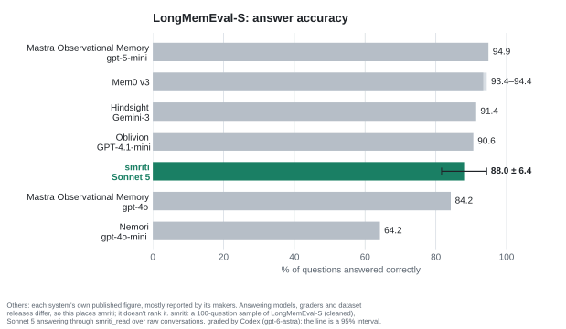

# Benchmarks

## LongMemEval (2026-11-09)

[LongMemEval](https://github.com/xiaowu0162/LongMemEval) (Wu et al., ICLR 2025)
asks questions about a user's past conversations with an assistant. This uses
its cleaned release of LongMemEval-S (`longmemeval_s_cleaned.json` from
[huggingface.co/datasets/xiaowu0162/longmemeval-cleaned](https://huggingface.co/datasets/xiaowu0162/longmemeval-cleaned),
MIT licence): 500 questions, each over its own history of 38 to 62 chat sessions
(about 115,000 tokens). The question types are single-session facts the user
gave, facts the assistant gave and preferences; facts spread over several
sessions; temporal reasoning; and knowledge updates. 30 questions can't be
answered from the history (abstention).

### What was measured, and what wasn't

- **smriti's search over the conversations.** Each question's history is
  written into a fresh memory root, one dated file per session in the
  day-log's render format (`conversations/YYYY/MM/DD-sNNN.md`), indexed by
  smriti's own indexer and searched by its own search, with the parameters
  `smriti_read` uses. `scripts/longmemeval.py` does this for any checkout.
- **Not smriti as installed.** An install doesn't index its raw day-log
  renders (`store/index_policy.py`): it searches the nightly digests and what
  the agent wrote. So these numbers say how well smriti finds a conversation it
  is given, not how much an install remembers of a day once the day is digested.
  Measuring that means running the nightly's digest over each history (one LLM
  call per conversation day), which isn't done here.
- **Embeddings.** smriti's default model, bge-m3 int8 under onnxruntime, embeds
  about one chunk a second on this machine's CPU, and the 500 histories make
  257,000 chunks. The vectors came instead from bge-m3's full-precision ONNX
  export on a GPU (an RTX 3090, 60 to 100 chunks a second), through a cache the
  harness puts in front of the provider. The two models' vectors for the same
  text have a cosine of 0.965 to 0.975. Three questions ran to the end with the
  int8 model before memory ran short (see below): every measure matched the
  stand-in's, with 89% of the top-10 sessions in common. That is too few to
  say more than that the stand-in isn't far off. Both checkouts read the same
  cache, so the before/after comparison doesn't depend on the stand-in.

### Search: all 500 questions

Over the 470 answerable questions. Session recall@k: an evidence session among
the first k sessions of a 50-chunk ranking (any: one of them; all: every
one). The agent's view is the 5 results `smriti_read` returns by default, and
of each the 1,000 characters it shows: whether one comes from an evidence
session, and whether one shows part of an evidence turn.

| | recall_any@5 | recall_all@5 | recall_any@10 | recall_all@10 | NDCG@10 | MRR | agent: evidence session | agent: evidence turn |
|---|---|---|---|---|---|---|---|---|
| hybrid, before (`d5543b6`) | 0.985 | 0.889 | 0.994 | 0.957 | 0.939 | 0.943 | 0.972 | 0.843 |
| hybrid, after (`49d31d5`) | 0.985 | 0.891 | 0.994 | 0.957 | 0.937 | 0.941 | 0.972 | 0.843 |
| keyword only, before | 0.962 | 0.806 | 0.985 | 0.898 | 0.887 | 0.899 | 0.945 | 0.794 |
| keyword only, after | 0.962 | 0.806 | 0.985 | 0.898 | 0.887 | 0.899 | 0.945 | 0.794 |

Before is the commit of the first outside review (2026-11-04); after is master
once hardening H1-H14 were done. By question type, after, hybrid:

| type | n | recall_any@5 | recall_all@10 | NDCG@10 | agent: evidence turn |
|---|---|---|---|---|---|
| knowledge-update | 72 | 1.000 | 1.000 | 0.985 | 0.889 |
| multi-session | 121 | 0.983 | 0.942 | 0.927 | 0.851 |
| single-session-assistant | 56 | 1.000 | 1.000 | 0.987 | 0.964 |
| single-session-preference | 30 | 0.967 | 0.967 | 0.842 | 0.567 |
| single-session-user | 64 | 0.984 | 1.000 | 0.973 | 0.812 |
| temporal-reasoning | 127 | 0.976 | 0.906 | 0.902 | 0.835 |

Per question, indexing took a median 1.25 s before and 1.07 s after (vectors
from the cache, so this is chunking and the database); a search, 11.6 ms and
12.7 ms. Both versions make the same 256,837 chunks.

### Answers: 100 questions

A sample of 100 (seeded, in proportion to the question types, 9 of them
unanswerable). For each, Claude Sonnet 5 (`claude -p`) answered with one tool,
`smriti_read`, over that question's root, told the question's date and to say
when its memory doesn't hold the answer; it had no other tools, no user
settings, hooks or memory. Codex (gpt-6-astra) graded each answer against the
gold answer with rules following LongMemEval's judge prompts (an off-by-one in
a count of days is accepted; a knowledge update needs the latest value; a
preference answer is graded against a rubric; an abstention is correct when the
answer says the history doesn't hold it). Every failure and 14 of the passes
were read by hand; the grades held. The runner lives outside this repository,
since it copies a Claude Code login into a throwaway configuration.

| | n | correct |
|---|---|---|
| all | 100 | 88% |
| answerable | 91 | 86.8% |
| abstention | 9 | 100% |
| knowledge-update | 13 | 100% |
| single-session-user | 12 | 100% |
| temporal-reasoning | 24 | 91.7% |
| single-session-assistant | 11 | 90.9% |
| multi-session | 25 | 72% |
| single-session-preference | 6 | 66.7% |

With 100 questions the overall figure is good to about six points either way.
The agent searched 2.1 times a question on average (at most 7), and an evidence
session was among what it saw for 90 of the 91 answerable questions.

### What it shows

- **The hardening didn't change search accuracy.** Before and after rank alike
  (top-10 sessions 98.9% the same, every question's recall_any@5 the same).
  Two questions lost first place to a later conversation on the same topic,
  through "a later version takes the earlier's place" (H13.12), which gained
  nothing here: knowledge-update questions already scored 1.000.
- **Finding the conversation is not the bottleneck at this size.** Keyword
  search alone puts an evidence session in the first five for 96.2% of
  questions; vectors add two points, and more on the stricter measures
  (recall_all@5 0.806 to 0.891).
- **What reaches the agent is.** Part of an evidence turn is in what
  `smriti_read` shows for 84% of questions, 57% for preferences. Results are
  cut at 1,000 characters, and a single long line becomes one chunk of up to
  24,000 characters, since the chunker splits only at line breaks. One graded
  failure was this: the agent saw three of four items and said the fourth was
  cut off.
- **Counting across sessions is the weak answer type** (72%): most failures
  were short counts, where the agent stopped searching after finding some of
  the sessions. For multi-session questions, recall_all@5 is 0.835 against
  recall_any@5's 0.983: search finds one of the sessions far more often than
  all of them.
- **A very long line can exhaust memory when it is embedded.** The chunker
  splits only at line breaks, so a line of 24,000 characters is one chunk of
  about 6,000 tokens; the onnx provider embeds 32 texts at a time, padded to
  the longest, so that batch's attention alone needs tens of gigabytes. Both
  the GPU run and the int8 run hit it on this data (the int8 run was stopped
  for it). A memory tree rarely has such a line (the reference tree's longest
  chunk is 3,481 characters), but a pasted log or a paragraph without breaks
  would make one.
- **"Nothing is close" never fired**: for none of the 30 unanswerable questions
  and none of the answerable ones. The model's calibration (chosen on the
  synthetic quality set, for the int8 model) doesn't separate them here. The
  answering agent still declined all 9 unanswerable questions in the sample.

### For context

<picture>
  <source media="(prefers-color-scheme: dark)" srcset="img/longmemeval-dark.svg">
  
</picture>

Published LongMemEval-S results are mostly answer accuracy, with GPT-4o as the
grader and each system's own answering model, and mostly reported by the
systems' makers: Mastra Observational Memory 94.9% (gpt-5-mini) and 84.2%
(gpt-4o) on the same memory, Mem0's platform 93.4-94.4%, Hindsight 91.4%,
Oblivion 90.6%, Nemori 64.2% (gpt-4o-mini). Retrieval-only claims include
MemPalace's 96.6% recall_any@5 (disputed) and Supermemory's 97% Recall@20.
None of these is like for like with the figures above: a different answering
model, grader, dataset release or measure, and smriti's search here ran over
raw conversations. Mastra's pair shows how much the answering model alone
moves the score.

### Reproduce

```bash
# the data: longmemeval_s_cleaned.json from the link above
python scripts/longmemeval.py run <checkout> --data longmemeval_s_cleaned.json --jobs 4 \
    --vectors vectors.db --label after     # lists the texts the cache lacks
python scripts/longmemeval.py embed --vectors vectors.db --misses <run>/misses-*.jsonl \
    --model <dir with model.onnx and tokenizer.json>   # a GPU with onnxruntime-gpu
python scripts/longmemeval.py run <checkout> --data longmemeval_s_cleaned.json --jobs 4 \
    --vectors vectors.db --label after     # now complete
python scripts/longmemeval.py report <run> [<another run>]
```

Without `--vectors` the checkout's own model computes every vector (slow on a
CPU). See the script's docstring for what each measure counts. The chart is
drawn by `python scripts/longmemeval_chart.py` (needs matplotlib), which holds
each published figure with its source.
